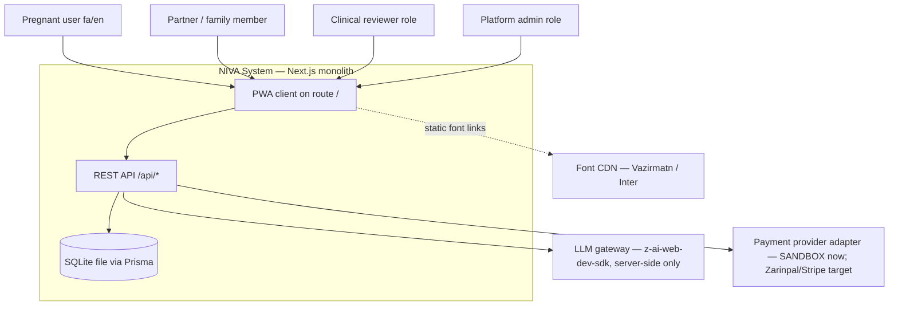
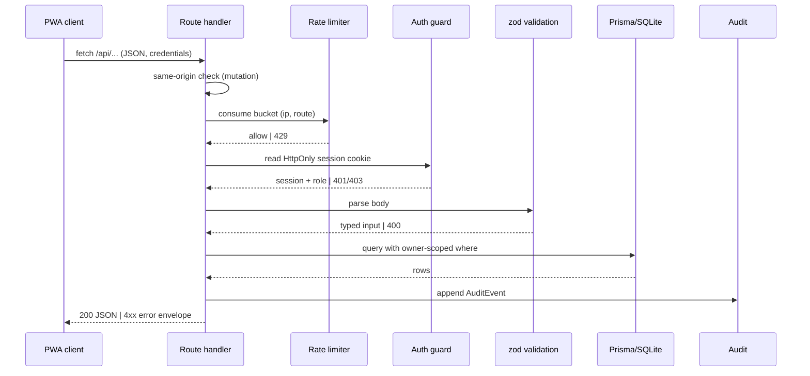
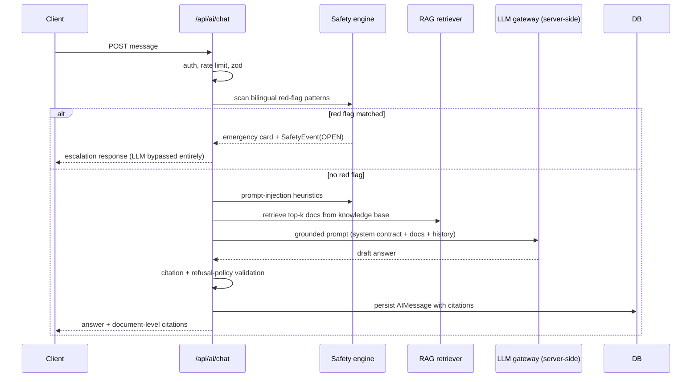

# NIVA — System Architecture Document

| Field | Value |
| --- | --- |
| Document | 01-system-architecture.md |
| Version | 1.0 (architecture baseline) |
| Task | 2-a |
| Related | 00-executive-summary.md, 02-data-model.md, 03-api-spec.md, 05-3d-asset-spec.md, 07-security-privacy.md, 10-backlog-risk.md |

Status vocabulary used throughout: SPECIFIED (defined here, implementation pending),
IMPLEMENTED (sandbox) (exists in the current build), DOCUMENTED-TARGET (production
intention, deferred), DEFERRED (consciously postponed).

## 1. C4 Level 1 — System context

NIVA is one deployable web system with four human actor types and a small set of external
services. The context diagram shows trust boundaries: all actor traffic enters through the
web/PWA client; the server never exposes the LLM gateway or database to the client.

External interactions: (a) LLM gateway called exclusively from server code after the
deterministic safety layer (see section 8); (b) payment webhooks call the API — in the
current build they are HMAC-verified requests from the labeled SANDBOX adapter, in the
target they originate from Zarinpal/Stripe; (c) font CDN supplies static assets.

## 2. C4 Level 2 — Containers (current build)

| Container | Technology | Responsibility |
| --- | --- | --- |
| Web client | React 19 SPA hosted by Next.js App Router at route `/`, Tailwind 4 + shadcn/ui (New York), zustand store, client view router | All rendering, i18n/RTL, 3D studio, onboarding; talks only to `/api/*` |
| API monolith | Next.js 16 route handlers (Node runtime), ~30 handler files under `src/app/api` | Auth, RBAC, validation (zod), rate limiting, RAG + safety pipeline, payments, admin |
| Database | SQLite file `db/custom.db` via Prisma 6 | Single source of durable state in the sandbox |
| Static/PWA layer | Next.js static assets, manifest + service worker | Installability and offline shell for the client |

Documented-target containers (production): PostgreSQL cluster (migrations), Redis +
BullMQ worker processes (notifications, exports, review scheduling), S3-compatible object
storage with malware scanning, an isolated RAG/model-gateway service, CDN, OpenTelemetry
collector, and React Native + Expo mobile apps consuming the same API (ADR-010).

## 3. C4 Level 3 — Components inside the monolith

| Component (proposed/actual location) | Owns |
| --- | --- |
| `src/lib/db.ts` | Prisma client singleton |
| `src/lib/auth` | scrypt password hashing, session issue/rotate/revoke, cookie handling, role guards |
| `src/lib/rate-limit` | In-memory per-IP/per-route token buckets (Redis target) |
| `src/lib/validation` | zod schemas per endpoint, shared types |
| `src/lib/i18n` | fa/en dictionaries, `t()`, dir/lang switching |
| `src/lib/safety` | Bilingual red-flag pattern engine, emergency card model, SafetyEvent writer |
| `src/lib/rag` | Corpus index over `src/data/medical-knowledge.ts`, retrieval, prompt assembly, citation emission |
| `src/lib/payments` | Provider adapter interface + SANDBOX adapter + webhook verification + idempotency |
| `src/lib/entitlements` | Entitlement evaluation (server-side source of truth) |
| `src/lib/audit` | AuditEvent append helper and query guards |
| `src/data/*` | Medical knowledge base, red-flag patterns, anatomical proportion tables, content records, dictionaries |
| `src/components/three/*` | R3F scene graph, parametric fetus generator, layers, hotspots, LOD controls (spec: 05-3d-asset-spec.md) |
| `src/components/ui/*` | shadcn/ui New York inventory (spec: 04-design-system.md) |
| `src/app/page.tsx` | Client-side view router, single user-visible route |
| `src/app/api/*` | Route handler groups (spec: 03-api-spec.md) |

## 4. Bounded contexts

| Context | Modules (00-executive-summary.md §5) | Core entities | API group |
| --- | --- | --- | --- |
| Identity & access | A | User, Session, Consent | auth |
| Pregnancy domain | B, C | Pregnancy, GestationalDating, PregnancyEvent | pregnancy, content |
| Visualization | D, E | AnatomicalAsset | assets |
| Health tracking | F, G | SymptomEntry, PregnancyEvent | tracking |
| Records & planning | H, I | Reminder, Appointment, MedicalDocument | reminders, appointments, documents |
| AI assistant | J | AIConversation, AIMessage, SafetyEvent | ai |
| Education | K–O | EducationalContent, ScientificSource, ClinicalReview | content |
| Family | P | PartnerAccess | family |
| Community | Q | CommunityPost, ModerationAction | community |
| Commerce | S | Subscription, Payment, Entitlement | subscription |
| Platform ops | R, T, U, V, W, X, Y | Notification, AuditEvent, Setting | notifications, privacy, admin, content |

A context may read another context's data through the server layer only; no client path
reads across ownership boundaries. Object-level ownership rules are defined in
`07-security-privacy.md` §4.

## 5. Request flow (authenticated mutation)

Every mutation passes the same gauntlet in the same order: origin check, rate limit,
authentication, authorization (role + ownership), validation, write, audit. This uniform
order is itself the security review checklist (`07-security-privacy.md` §4–§6).

## 6. AI + safety data flow

Determinism rule: the safety scan runs before any token is generated and its decision is
final; there is no code path where a red-flag message reaches the LLM. Details, taxonomy,
and the LLM hard-constraint contract are in `06-medical-safety.md`; evaluation of this
pipeline is in `08-ai-evaluation.md`.

## 7. Single-route client view router (rationale)

The sandbox gateway exposes exactly one user-visible application route (`/`); deeper
paths are reserved. The client therefore implements a state-driven view router inside
`page.tsx`: a zustand `view` slice + typed view ids (the 20 screens of
`04-design-system.md` §7), history synchronization via `history.pushState`, deep-link
parameters for shareable states (e.g. studio week), and scroll restoration per view.

Consequences: server components are limited to the shell; data fetching happens through
the API from client components; back/forward work via popstate. The production target
(Authoritative Contract for production) restores real App Router routes per screen, which
the view-id enum was designed to map onto one-to-one. ADR-002 records the decision.

## 8. API-first design

Rules the implementation follows (contract: `03-api-spec.md`):

1. All state changes are REST calls to `/api/*`; no server actions in the current build.
2. JSON in/out with the standard error envelope; status codes limited to the catalog set
   (400/401/403/404/409/429 plus 2xx).
3. Every handler validates input with zod and returns zod-inferred response shapes where
   feasible, so the contract and code cannot drift silently.
4. Roles and ownership are enforced in the handler, never inferred from hidden UI.
5. Idempotency is explicit where money or retries exist (payments): unique idempotency keys
   and an idempotent, HMAC-verified webhook.
6. The catalog in `03-api-spec.md` is the authoritative contract; an OpenAPI 3.1 document is
   the adoption path (§13 of that file), generated from the same zod schemas.

## 9. 3D engine design (overview)

The studio renders a parametric, procedurally generated fetus inside an R3F `<Canvas>`:
geometry is derived from keyframed anatomical proportion tables per gestational week
(head/body ratio, limb development flags, and more), composed with uterus, placenta, and
cord layers, hotspots, and a guided-mode step machine. Rendering is device-adaptive (DPR
clamps, LOD tiers), honors reduced-motion, and detects WebXR for AR. The full specification
— parameter tables, registry fields, budgets, integrity rules, and the future
Blender-to-glTF scanned-asset pipeline — is `05-3d-asset-spec.md`. ADR-004 records why the
current build is parametric rather than scan-based.

## 10. Deployment topology

Current (sandbox): a single Node process (Next.js standalone served via bun) behind the
sandbox gateway; SQLite file on local disk; LLM gateway reachable from the process; fonts
from CDN; no external queues or object storage.

Target: stateless app instances behind a load balancer; managed PostgreSQL with migrations
and PITR; Redis + BullMQ workers; S3-compatible storage with AV scanning; RAG/model gateway
as a separate service with its own scaling and audit; CDN for static + assets; OpenTelemetry
tracing/metrics/logs; staging and production environments with IaC and CI/CD; mobile apps
optional clients of the same API. The migration order and dependency of each step is listed
in `10-backlog-risk.md` Phases 9+ (production hardening).

## 11. Architecture decision records

Status legend: Accepted = current guidance; Superseded/Deprecated would appear here if
revisited.

### ADR-001 — SQLite now, PostgreSQL as production target

- Context: The sandbox provides a file-based SQLite database and no managed Postgres.
  NIVA needs relational integrity, transactions, and a clean growth path.
- Decision: Use Prisma with SQLite (`db/custom.db`) in the current build, keep the schema
  portable (no SQLite-only types, no raw SQL dialect constructs), and define a one-way
  migration to PostgreSQL as a Phase-9+ item with `prisma migrate` as the cutover tool.
  Mapping notes live in `02-data-model.md` §8.
- Consequences: Simple dev loop and zero-ops storage now; concurrency limits and no PITR
  in the sandbox (accepted, documented in `07-security-privacy.md` §14); migration cost is
  bounded by schema discipline; JSON columns and enums require type-mapping work at cutover.
- Status: Accepted.

### ADR-002 — Single-route SPA view router vs App Router pages

- Context: The sandbox gateway constraint exposes one user-visible route. Next.js App
  Router naturally wants one route per screen.
- Decision: Implement a typed client-side view router inside `/` with history
  synchronization now; design view ids to map 1:1 to future App Router routes; keep all
  state changes in the API layer so views are swappable.
- Consequences: First-paint is client-rendered and SEO is limited in the sandbox (accepted
  for an authenticated product shell); deep links work via pushState; migrating to real
  routes later is mechanical but touches all 20 screens (tracked in `10-backlog-risk.md`).
- Status: Accepted (constraint-driven; revisit when the gateway constraint lifts).

### ADR-003 — Custom session auth vs NextAuth

- Context: `next-auth` exists in the dependency tree, but NIVA's needs are narrow
  (email+password, server sessions, three roles, logout-all) and its safety requirements
  demand full control of session rotation and audit.
- Decision: Implement first-party session auth: scrypt password hashing, opaque server-side
  session tokens in HttpOnly SameSite=Lax cookies, rotation on login, logout-all, explicit
  role guards per handler. No OAuth providers at launch.
- Consequences: Full auditability and no provider lock-in; we own password-reset, account
  lockout, and future MFA (MFA is a documented gap — `07-security-privacy.md` §14);
  NextAuth remains available if social login is added later.
- Status: Accepted.

### ADR-004 — Parametric procedural 3D vs scanned GLB pipeline

- Context: Scientifically faithful fetal models require clinical review, licensing clarity,
  and heavy asset production. The sandbox has neither reviewed assets nor an asset pipeline.
- Decision: Generate the fetus procedurally from keyframed anatomical proportion tables per
  gestational stage (head/body ratio, limb development flags, and so on), governed by an
  AnatomicalAsset registry with reviewStatus; ship everything labeled DEMONSTRATION. Define
  the Blender→glTF production pipeline for future scanned/reviewed assets
  (`05-3d-asset-spec.md` §12).
- Consequences: Tiny payload, week-continuous morphing, no licensing exposure now; visual
  fidelity is schematic and must be labeled as an educational schematic (integrity rules §11
  of the 3D spec); scanned assets arrive later behind the same registry interface.
- Status: Accepted (time-boxed; ADR-009 constrains its claims).

### ADR-005 — In-process RAG vs isolated model gateway service

- Context: An isolated RAG service is the production-grade shape (separate scaling, secret
  blast radius, independent audit). The sandbox runs a single Node process.
- Decision: Run RAG in-process over a curated bilingual knowledge base
  (`src/data/medical-knowledge.ts`) with document-level citations, and call the LLM gateway
  only from server code behind the deterministic safety layer. Define the service split
  (same request contract, queue-backed) as a DOCUMENTED-TARGET refactor.
- Consequences: Simple, auditable, zero-network retrieval now; model latency sits inside
  the web request (bounded by rate limits); the split later is an extraction, not a rewrite,
  because the pipeline is already stage-separated (section 6).
- Status: Accepted for the sandbox build; revisit at production scale.

### ADR-006 — Payment provider-adapter pattern, sandbox-first

- Context: Two markets imply two processors (Zarinpal-class for Iran, Stripe-class
  international). No real credentials can exist in the sandbox, and payment code that is
  tested only in production is a compliance hazard.
- Decision: Define a `PaymentProvider` adapter interface; implement a fully labeled SANDBOX
  adapter (HMAC-verified webhook, idempotent processing, unique idempotency keys) and keep
  Zarinpal/Stripe adapters specified but unwired. The server-side Entitlement table is the
  only source of truth for what a user may access; the client never gates alone.
- Consequences: Entitlement logic, webhook idempotency, and state machines are tested
  without money; going live is an adapter implementation plus credential management under
  secrets policy (`07-security-privacy.md` §8); sandbox flows are labeled in UI to prevent
  any perception of real charges.
- Status: Accepted.

### ADR-007 — Dictionary i18n vs next-intl

- Context: `next-intl` is available, but the single-route SPA and the sandbox gateway
  complicate locale-segmented routing; NIVA needs runtime RTL/LTR switching on one route.
- Decision: Implement a lightweight typed dictionary i18n (`fa`/`en`), runtime `dir`
  switching on the document element, per-locale font loading, and per-language fields in
  content records. Keep messages in code-reviewable dictionaries.
- Consequences: No routing integration to maintain in the sandbox; we forgo next-intl's
  pluralization/ICU tooling and must own quality checks (i18n risk:
  `10-backlog-risk.md` R13); migration to next-intl later is possible because dictionaries
  are plain objects.
- Status: Accepted.

### ADR-008 — Clinical content governance workflow

- Context: Education content and 3D assets influence health behavior; publishing unreviewed
  material is the platform's worst failure mode.
- Decision: All clinical-adjacent content (modules C, K–O) and all anatomical assets pass a
  state machine DRAFT → IN_REVIEW → APPROVED/REJECTED with a CLINICAL_REVIEWER role,
  immutable versions, reasons on rejection, and audit on every transition. The UI renders
  only APPROVED content to users; anything unapproved is labeled DEMONSTRATION at most and
  is never presented as clinical guidance. No content is clinically approved until
  documented human review evidence exists (`06-medical-safety.md` §9).
- Consequences: Content velocity is gated by reviewer capacity (risk R14 in
  `10-backlog-risk.md`); the sandbox ships with honest DEMONSTRATION labels rather than
  fake approvals.
- Status: Accepted.

### ADR-009 — Demonstration assets policy

- Context: The 3D studio needs to ship before clinically reviewed models exist.
- Decision: Ship parametric assets under registry status DEMONSTRATION with a permanent,
  visible "educational schematic — proportions approximate, not a medical image" label in
  both languages; forbid heartbeat, movement, or diagnostic readings from the scene; the
  DEMONSTRATION status is data (registry), not a removable string.
- Consequences: Users get a working studio without deception; removing the label requires a
  registry state change (i.e., real review), which is the point.
- Status: Accepted.

### ADR-010 — PWA-first vs store applications

- Context: Iran distribution is constrained by store policies and sanctions; international
  users expect installability; native apps multiply compliance surface.
- Decision: Web + PWA is the launch channel (manifest + service worker on the single
  route). Android/iOS via React Native + Expo are DOCUMENTED-TARGET, with a Capacitor wrap
  as fallback; store compliance work is scoped before any submission.
- Consequences: Fastest iteration and one codebase now; push notifications and some
  hardware APIs wait for native work (module R partial); store presence is a marketing
  decision deferred until compliance is real.
- Status: Accepted for launch.

## 12. Consistency rules for the rest of the suite

1. `03-api-spec.md` is the contract; route handlers are its implementation, not its source.
2. `02-data-model.md` is the schema authority; Prisma schema files implement it.
3. `06-medical-safety.md` overrides any convenience elsewhere where safety behavior differs.
4. Status labels across docs must match `00-executive-summary.md` §5; discrepancies are
   bugs in documentation and are fixed in both places.
5. Anything not claimable is labeled with the vocabulary at the top of this file — never
   with marketing adjectives.
