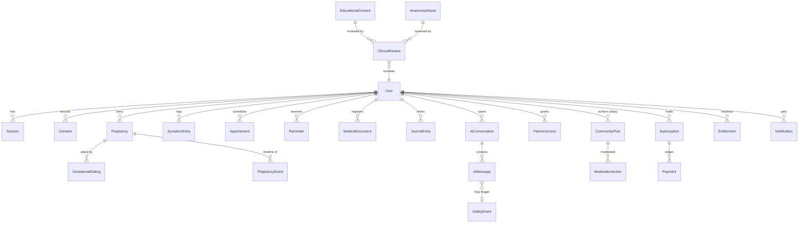

# NIVA — Database Design (Data Model)

| Field | Value |
| --- | --- |
| Document | 02-data-model.md |
| Version | 1.0 (architecture baseline) |
| Task | 2-a |
| Related | 01-system-architecture.md, 03-api-spec.md, 07-security-privacy.md |

This is the schema authority for the current build (Prisma + SQLite, `db/custom.db`) and
the migration source for the PostgreSQL target (ADR-001 in `01-system-architecture.md`).
Field types are given in Prisma-style notation. All entities carry `id String @id
(cuid)` plus `createdAt`/`updatedAt` unless stated otherwise; those columns are omitted
below for brevity. Enumerations are stored as TEXT with TypeScript/zod unions because
SQLite has no native enums (section 8).

## 1. Conventions

- Identifiers: `cuid()` strings; no autoincrement integers (safe for exports and merges).
- Timestamps: UTC `DateTime`; clients localize at render time.
- Deletes: user-facing deletes are soft or cascading per section 6; financial rows are
  never deleted (retention, section 9).
- Multi-language text: explicit paired columns (`titleFa`/`titleEn`) on content entities;
  a generic per-language JSON map is used for notifications.
- JSON columns (`Json`) are schema-validated at the application boundary with zod.

## 2. Identity & access context

| Entity | Fields | Relationships |
| --- | --- | --- |
| User | `email String @unique`, `passwordHash String`, `name String?`, `role String` (USER \| CLINICAL_REVIEWER \| ADMIN), `locale String` (fa \| en), `theme String?`, `isActive Boolean @default(true)` | 1→n Session, Consent, Pregnancy, SymptomEntry, Appointment, Reminder, MedicalDocument, JournalEntry, AIConversation, CommunityPost, PartnerAccess, Subscription, Payment, Entitlement, Notification; 1→n AuditEvent (actor) |
| Session | `userId String`, `tokenHash String @unique` (sha-256 of opaque token; raw token never stored), `expiresAt DateTime`, `userAgent String?`, `ip String?`, `revokedAt DateTime?` | n→1 User (cascade delete) |
| Consent | `userId String`, `purpose String` (DATA_PROCESSING \| AI_ASSISTANT \| COMMUNITY \| PARTNER_ACCESS \| ANALYTICS), `granted Boolean`, `lawfulBasis String`, `policyVersion String` | n→1 User; append-style history (new row per change) |

## 3. Pregnancy domain context

| Entity | Fields | Relationships |
| --- | --- | --- |
| Pregnancy | `userId String`, `status String` (ACTIVE \| COMPLETED \| LOST \| ARCHIVED), `startDate DateTime?`, `dueDate DateTime?`, `outcomeNote String?` | n→1 User; 1→n GestationalDating, PregnancyEvent, SymptomEntry, Appointment, JournalEntry, AIConversation |
| GestationalDating | `pregnancyId String`, `method String` (LMP \| ULTRASOUND_CRL \| IVF \| ADJUSTED), `referenceDate DateTime`, `gestationalAgeDays Int`, `dueDate DateTime`, `confidenceNote String?`, `enteredBy String` | n→1 Pregnancy; latest row wins (dating is re-datable, history kept) |
| PregnancyEvent | `pregnancyId String`, `type String` (CONTACT \| ULTRASOUND \| LAB_RESULT \| MILESTONE \| NOTE \| SYSTEM_ALERT), `title String`, `notes String?`, `occurredOn DateTime`, `source String` (USER \| SYSTEM) | n→1 Pregnancy |

Gestational dating aligns with the platform's clinical references (WHO 2016 antenatal care
recommendations' contact schedule; ACOG/ISUOG guidance treating first-trimester ultrasound
as the most accurate dating method). NIVA computes dating transparently and always shows
the method used; it never silently overrides a user-entered method.

## 4. Tracking & records context

| Entity | Fields | Relationships |
| --- | --- | --- |
| SymptomEntry | `userId String`, `pregnancyId String?`, `category String` (NAUSEA \| PAIN \| BLEEDING \| MOOD \| SLEEP \| OTHER), `severity Int` (1–10), `notes String?`, `redFlagTriggered Boolean @default(false)` | n→1 User, Pregnancy; write path runs the red-flag engine (06-medical-safety.md) |
| Appointment | `userId String`, `pregnancyId String?`, `title String`, `provider String?`, `location String?`, `scheduledAt DateTime`, `status String` (SCHEDULED \| DONE \| MISSED \| CANCELLED), `notes String?` | n→1 User |
| Reminder | `userId String`, `scope String` (APPOINTMENT \| TRACKING \| EDUCATION \| CUSTOM), `title String`, `dueAt DateTime`, `repeat String` (NONE \| DAILY \| WEEKLY), `status String` (PENDING \| DONE \| SNOOZED \| DISMISSED) | n→1 User |
| MedicalDocument | `userId String`, `title String`, `kind String` (LAB \| ULTRASOUND \| PRESCRIPTION \| REPORT \| OTHER), `notes String?`, `fileRef String?` (object-storage key — DOCUMENTED-TARGET; current build stores metadata only), `scanStatus String?` (PENDING \| CLEAN \| INFECTED — target) | n→1 User |
| JournalEntry | `userId String`, `pregnancyId String?`, `title String?`, `body String`, `mood String?` | n→1 User; private to owner unless a PartnerAccess grant explicitly includes journal read |

## 5. Content & governance context

| Entity | Fields | Relationships |
| --- | --- | --- |
| EducationalContent | `slug String @unique`, `module String` (C \| K \| L \| M \| N \| O), `weekFrom Int?`, `weekTo Int?`, `titleFa String`, `titleEn String`, `bodyFa String`, `bodyEn String`, `tags Json`, `reviewState String` (DRAFT \| IN_REVIEW \| APPROVED \| REJECTED), `version Int`, `supersedesId String?` | 1→n ClinicalReview; m→n ScientificSource via `sourceIds Json` of FKs |
| ScientificSource | `title String`, `publisher String`, `year Int`, `url String?`, `citationFa String`, `citationEn String`, `evidenceLevel String?` | referenced by EducationalContent, AnatomicalAsset, AI citations |
| ClinicalReview | `subjectType String` (CONTENT \| ASSET), `subjectId String`, `reviewerId String` (role CLINICAL_REVIEWER), `decision String` (PENDING \| APPROVED \| REJECTED \| CHANGES_REQUESTED), `comments String?`, `decidedAt DateTime?` | n→1 User; immutable once decided (new row for re-review) |
| AnatomicalAsset | `assetId String @unique`, `gestationalStage String`, `anatomicalStructures Json`, `scientificSourceIds Json`, `reviewerId String?`, `reviewStatus String` (DEMONSTRATION \| IN_REVIEW \| APPROVED \| REJECTED), `modelVersion String`, `animationMetadata Json`, `performanceProfile String` (LOW \| MID \| HIGH), `publicationStatus String` (UNPUBLISHED \| PUBLISHED \| RETIRED), `labels Json` (bilingual schematic labels) | n→1 User (reviewer); full field semantics in 05-3d-asset-spec.md §5 |

## 6. AI context

| Entity | Fields | Relationships |
| --- | --- | --- |
| AIConversation | `userId String`, `pregnancyId String?`, `locale String`, `title String?` | n→1 User; 1→n AIMessage |
| AIMessage | `conversationId String`, `role String` (USER \| ASSISTANT \| SYSTEM), `content String`, `citations Json` (document ids from the knowledge base), `redFlag Boolean @default(false)`, `safetyEventId String?`, `latencyMs Int?` | n→1 AIConversation; n→1 SafetyEvent |
| SafetyEvent | `userId String?`, `conversationId String?`, `patternId String`, `category String` (red-flag taxonomy, 06 §3), `severity String` (LOW \| MEDIUM \| HIGH \| CRITICAL), `source String` (CHAT \| SYMPTOM \| COMMUNITY), `status String` (OPEN \| TRIAGED \| RESOLVED), `payload Json`, `resolvedAt DateTime?`, `resolvedBy String?` | lifecycle managed in 06-medical-safety.md §10 |

## 7. Social, commerce, platform contexts

| Entity | Fields | Relationships |
| --- | --- | --- |
| PartnerAccess | `ownerUserId String`, `partnerUserId String?`, `partnerEmail String`, `permissions Json` (flags: viewTimeline, viewTracking, viewAppointments, viewJournal), `status String` (INVITED \| ACTIVE \| REVOKED), `revokedAt DateTime?` | n→1 User (owner); enforcement model in 07-security-privacy.md §4 |
| CommunityPost | `authorUserId String`, `alias String` (display identity, not real name), `body String`, `language String`, `flagStatus String` (NONE \| FLAGGED \| CLEARED), `flagReasons Json`, `isHidden Boolean @default(false)` | n→1 User; 1→n ModerationAction |
| ModerationAction | `postId String`, `moderatorId String` (role ADMIN), `action String` (CLEAR \| HIDE \| DELETE \| WARN), `reason String` | n→1 CommunityPost, User |
| Subscription | `userId String`, `plan String` (FREE \| PREMIUM_MONTHLY \| PREMIUM_ANNUAL), `status String` (ACTIVE \| CANCELLED \| PAST_DUE \| TRIAL), `provider String` (SANDBOX \| ZARINPAL \| STRIPE), `currentPeriodEnd DateTime?` | 1→n Payment; 1→n Entitlement |
| Payment | `userId String`, `subscriptionId String?`, `amountMinor Int`, `currency String` (IRR \| USD), `provider String`, `providerRef String? @unique`, `status String` (PENDING \| SUCCEEDED \| FAILED \| REFUNDED), `idempotencyKey String @unique`, `webhookVerified Boolean` | n→1 User; immutable ledger row |
| Entitlement | `userId String`, `feature String` (STUDIO_HD \| AI_UNLIMITED \| COMMUNITY \| EXPORT), `source String` (PLAN \| GRANT \| SANDBOX), `granted Boolean`, `expiresAt DateTime?` | `@@unique([userId, feature])`; server-side source of truth (ADR-006) |
| AuditEvent | `actorUserId String?`, `actorRole String?`, `action String`, `entityType String`, `entityId String?`, `ip String?`, `meta Json` | append-only; no update/delete code path (section 11) |
| Notification | `userId String`, `type String`, `titleKey String`, `bodyParams Json`, `readAt DateTime?` | n→1 User |
| Setting | `userId String?` (null = global), `key String`, `value Json` | `@@unique([userId, key])` |

## 8. ERD (principal relationships)

## 9. Indexes and unique constraints

| Entity | Constraint / index | Reason |
| --- | --- | --- |
| User | `email @unique` | auth lookup |
| Session | `tokenHash @unique`; index `(userId)`; index `(expiresAt)` | O(1) session validation; cleanup |
| Entitlement | `@@unique([userId, feature])` | single truth per feature |
| Payment | `idempotencyKey @unique`, `providerRef @unique` | webhook idempotency, double-charge protection |
| EducationalContent | `slug @unique`; index `(module, reviewState)` | content lookup, review queue |
| AnatomicalAsset | `assetId @unique`; index `(reviewStatus)` | registry loading, review queue |
| SafetyEvent | index `(status, createdAt)`, `(category)` | triage dashboard |
| AIMessage | index `(conversationId, createdAt)` | thread rendering |
| SymptomEntry | index `(userId, createdAt)` | trend queries |
| Reminder | index `(userId, dueAt, status)` | due list |
| CommunityPost | index `(flagStatus, createdAt)` | moderation queue |
| AuditEvent | index `(entityType, entityId)`, `(createdAt)` | investigations |
| Notification | index `(userId, readAt)` | unread badge |
| Setting | `@@unique([userId, key])` | upsert path |

SQLite note: Prisma enables foreign-key enforcement; `PRAGMA foreign_keys` stays ON in the
client configuration. SQLite allows only one writer at a time — acceptable in the sandbox,
a migration driver for PostgreSQL (section 11).

## 10. Referential integrity rules

1. Session, Consent, SymptomEntry, Appointment, Reminder, JournalEntry, AIConversation,
   Notification, Subscription, Entitlement, CommunityPost: `onDelete: Cascade` from User.
2. Payment: `onDelete: Restrict` from User at hard-delete time — account deletion
   anonymizes the user row instead (section 9 of 07), keeping the financial ledger intact.
3. AIMessage: cascade from AIConversation; SafetyEvent rows are never cascaded (safety
   records survive conversation deletion).
4. ClinicalReview rows are immutable; re-review creates a new row referencing the same
   subject; EducationalContent versioning appends new rows and marks `supersedesId`.
5. PartnerAccess is revoked (status update), not deleted, so grant history stays auditable.
6. ModerationAction references posts by id; hard-deleting a post is a DELETE action row and
   the post row is tombstoned (`isHidden` + `flagStatus`), not physically removed.
7. Cross-context reads go through server queries that always include the ownership
   predicate; the client cannot request another user's rows (IDOR rules, 07 §4).

## 11. SQLite → PostgreSQL migration notes (ADR-001 cutover)

- Type mapping: TEXT→`text`; Json→`jsonb`; DateTime→`timestamptz`; Int/Float unchanged;
  Boolean unchanged. Enum unions stay TEXT initially; optional `CREATE TYPE` pg enums later.
- ID strategy: keep `cuid()` strings at cutover (no key regeneration); optional move to
  uuidv7 afterwards in a dedicated migration if needed.
- Switch datasource provider to `postgresql`, run `prisma migrate diff` to generate the
  baseline DDL, then adopt `prisma migrate` (the current build uses `db push`, acceptable
  only in the sandbox).
- Partial indexes: add `where readAt is null` on Notification and similar in pg-only DDL.
- Concurrency: introduce pgbouncer-compatible pool settings; move rate limiting and any
  in-process scheduling to Redis (07 §14).
- Data migration: one-time ETL export from SQLite (JSON dump via Prisma) → bulk insert →
  checksum verification per table; freeze writes during cutover window.
- Verification: run the golden-path E2E suite (`09-test-plan.md` §5) against the pg build.

## 12. Retention policy

| Data | Retention | Basis / trigger |
| --- | --- | --- |
| Sessions | deleted 90 days after expiry | hygiene |
| Consent records | life of account + 3 years | proof of lawful basis |
| Pregnancy & tracking data | until user delete request; purge ≤ 30 days after account deletion | user rights |
| Journal entries | until user deletes; purge with account | user rights |
| AIMessage transcripts | 24 months rolling, then deleted | quality + safety review horizon |
| SafetyEvent | 5 years | safety governance record |
| AuditEvent | 3 years, append-only | accountability |
| Payment / Subscription | 7 years | financial/legal record keeping |
| CommunityPost | until author deletes or moderation tombstones; tombstones 90 days then purged | community integrity |
| Notification | deleted 90 days after read | hygiene |
| MedicalDocument metadata | until user deletes | user rights |

Account deletion executes these rules via the privacy workflow (`03-api-spec.md` privacy
group; `07-security-privacy.md` §10).

## 13. Encryption boundaries

| Layer | Current build | Production target |
| --- | --- | --- |
| In transit | TLS at the gateway; HSTS expected from gateway | TLS everywhere incl. internal service links |
| DB file at rest | SQLite file on host disk; no platform encryption in sandbox — honest gap (07 §14) | managed volume encryption + backups encrypted |
| Passwords | scrypt with per-user salt; never reversible | unchanged |
| Session tokens | stored only as sha-256 hash | unchanged |
| Sensitive narrative fields (journal body, symptom notes, document notes) | plaintext in DB in the sandbox | application-level envelope encryption with KMS-managed keys |
| LLM API keys | server-side env only; never shipped to client | vault-managed, rotated |

## 14. Audit trail design

`AuditEvent` is the single append-only stream. Writers: auth (register, login, logout,
logout-all, failed login), role/entitlement changes, clinical review decisions, moderation
actions, privacy operations (export, delete, consent change), payment webhook acceptance,
SafetyEvent status transitions. Readers: the actor (own events via privacy view), ADMIN
(query API in `03-api-spec.md` admin group). Integrity target (DOCUMENTED-TARGET): daily
hash-chaining of the stream and export of chain roots to immutable storage. Audit rows
never contain free-text health content — they reference entity ids and action codes only.

## 15. Backup and recovery

- Current build: SQLite file backup — copy `db/custom.db` with the app stopped (or use
  `sqlite3 db/custom.db ".backup ..."` online), retain N daily copies outside the webroot;
  documented restore drill: stop server, replace file, start, run golden-path smoke
  (`09-test-plan.md` §5.2).
- Target: managed PostgreSQL with PITR — RPO ≤ 5 minutes, RTO ≤ 1 hour; quarterly restore
  drills recorded in the worklog; S3 bucket versioning for uploaded documents; Secrets and
  env config captured in IaC.
- Backup encryption and access control follow `07-security-privacy.md` §8.
