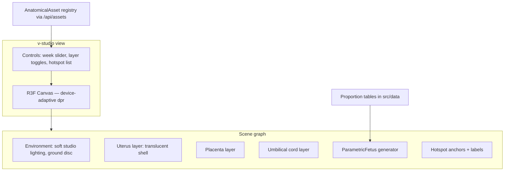

# NIVA — 3D Studio & Asset Specification

| Field | Value |
| --- | --- |
| Document | 05-3d-asset-spec.md |
| Version | 1.0 (architecture baseline) |
| Task | 2-a |
| Related | 01-system-architecture.md ADR-004/009, 02-data-model.md §5, 06-medical-safety.md |

The 3D studio is a scientific-educational visualization of fetal development across
gestational weeks. Current build: React Three Fiber (R3F) + drei over React 19, with a
parametric procedural fetus generated from keyframed anatomical proportion tables —
explicitly NOT a single scaled model. All assets are registry-governed and honestly labeled
DEMONSTRATION pending clinical review (ADR-009).

## 1. Goals and non-goals

Goals: continuous week interpolation (weeks 4–40), anatomically proportioned schematic,
layered anatomy (fetus, uterus, placenta, umbilical cord), hotspot education, guided mode,
smooth performance from low-end phones to desktop, accessible alternatives, AR where the
browser supports it.

Non-goals: diagnostic imagery, real-time physiological claims (heartbeat, fetal movement
monitoring), photorealism, medical training fidelity. See section 11.

## 2. Engine architecture

- `ParametricFetus` builds geometry from the active week's parameter row (section 3):
  head sphere/ellipsoid scaling, torso curve, limb cylinders with development flags,
  facial feature suppression by stage. Geometry is deterministic and cheap; morphing
  between weeks lerps parameter rows, never meshes.
- Materials: matte subsurface-like shader tint; uterine shell uses additive transparency;
  no postprocessing chain beyond tone mapping (budget, section 10).
- State: zustand slice holds week, layers, guided-mode step, quality tier; URL params
  deep-link a week (ADR-002).

## 3. Parametric model — parameter table per gestational stage

The generator consumes keyframed rows; values are editorial approximations from the
knowledge base and are treated as schematic (labeling, section 11). Representative rows:

| Stage (weeks) | Head:body ratio | Limb development flags | Eyes | Skin/translucency | Size cue |
| --- | --- | --- | --- | --- | --- |
| 4–8 (embryonic) | ~1:1 (large cephalic) | buds only; no digits | optic discs, no lids | highly translucent | mm-scale |
| 9–14 (early fetal) | ~1:1.2 | arms/legs lengthen; digits separated | lids fused | translucent, vessels hinted | cm-scale |
| 15–26 (mid fetal) | ~1:2 | proportions refine; joints articulated | lids unfuse late; eyebrows | less translucent, lanugo hint | ~15–35 cm CHL |
| 27–40 (late fetal) | ~1:4–1:5 | fat fill; mature proportions | eyes open; lashes | opaque, skin tone shift | ~35–50 cm CHL |

Full table: per-week rows with fields `week, headRatio, crlOrChlMm, armStage(0–4),
legStage(0–4), fingerStage(0–3), lidState, opacity, lanugo, vernix, positionPreset`.
Keyframes are reviewed under the same governance as content (`06-medical-safety.md` §7);
the table ships with the DEMONSTRATION status until review completes.

## 4. Asset registry (AnatomicalAsset, 02-data-model.md §5)

| Field | Meaning |
| --- | --- |
| `asset_id` | stable registry id referenced by scene code |
| `gestational_stage` | week or stage key this record covers |
| `anatomical_structures` | structures present (fetus, uterus, placenta, cord, plus part list) |
| `scientific_sources` | FK list to ScientificSource rows supporting proportions |
| `reviewer` | CLINICAL_REVIEWER user id, when reviewed |
| `review_status` | DEMONSTRATION \| IN_REVIEW \| APPROVED \| REJECTED |
| `model_version` | generator + table version (semver), e.g. `param-1.2.0` |
| `animation_metadata` | allowed idle-motion descriptors (see integrity rules) |
| `performance_profile` | LOW \| MID \| HIGH rendering profile |
| `publication_status` | UNPUBLISHED \| PUBLISHED \| RETIRED |

Rules: the studio renders only `publication_status = PUBLISHED` records; each rendered
surface shows `review_status` truthfully (DEMONSTRATION badge, 04 §10); a record whose
review is REJECTED is pulled from publication automatically.

## 5. Interaction specification

- Camera: orbit + zoom + pan on one target (the fetus group); zoom clamped to keep the
  model between 20% and 90% of viewport; pan clamped to a small radius; damping on.
- Layers: toggles for uterus shell, placenta, cord; fetus always visible; toggles persist
  per session.
- Hotspots: anchored 3D points with bilingual labels (fa/en) and a citation each; tap/click
  opens a side panel with structure description + source; hotspots have text-only fallback
  in the accessibility panel.
- Guided mode: a step machine that sequences camera + layer + hotspot states ("visit the
  placenta", "observe head-to-body proportion this week") with next/prev controls,
  keyboard operable, and completable in reduced-motion (cuts straight to framing).
- Week slider: continuous scrubbing morphs parameters; snapping to integer weeks; the
  current week label is always visible and localized.

## 6. LOD and device-adaptive rendering

| Tier | Detection heuristic | dpr clamp | Geometry | Shadows |
| --- | --- | --- | --- | --- |
| LOW | coarse pointer + small memory heuristic, or fps monitor degrade | 1.0 | reduced segments, hotspots text-only billboards | off |
| MID | default mobile | 1.5 | standard | soft, single light |
| HIGH | desktop / large memory | 2.0 | full segments + cord detail | soft, two lights |

A runtime fps monitor can step a session down (HIGH→MID→LOW); it never steps up mid-session
(anti-oscillation). The scene is the only WebGL canvas; it unmounts when leaving the view.

## 7. Performance budgets

- Initial studio interaction ≤ 300 KB additional JS beyond the app shell; no external
  model files in the current build (procedural geometry).
- Frame time: 16.7 ms (60 fps) on HIGH tier, 33 ms (30 fps) floor on LOW tier with visible
  degrade path; measured via the fps monitor and recorded in `09-test-plan.md` §6.
- Draw calls target < 60 at HIGH; memory < 250 MB on mobile.
- Budget violations are release blockers tracked through quality gates (`09-test-plan.md` §8).

## 8. AR strategy

- Current build: WebXR capability detection only — if `navigator.xr` supports immersive-ar,
  the studio offers an "View in AR" affordance; otherwise the button is hidden (no broken
  promises). Scene content identical to inline mode; one-plane placement; no anchoring
  persistence.
- DOCUMENTED-TARGET: richer AR lessons (guided AR education module E) and native ARCore/
  ARKit paths via the React Native + Expo apps with image/plane anchoring and offline
  model cache, behind the same registry contract.
- AR inherits every integrity rule in section 11 without exception.

## 9. Accessibility alternatives

1. Full text alternative: per-week narrative description of what the schematic shows
   (bilingual), provided by the same content pipeline and citations as articles.
2. Hotspot list view: every hotspot as a focusable list item; selecting it shows the same
   panel as the 3D interaction.
3. Reduced motion: static frame, no auto-rotate, guided mode without camera animation
   (04 §5).
4. Keyboard: slider, layer toggles, guided-mode controls, and hotspot list are all tab
   reachable with visible focus (04 §9); the canvas itself is aria-labeled and does not
   trap focus.
5. Non-3D fallback: a structured "week card" (text + simple SVG proportion silhouette) is
   available when WebGL is unavailable or the user opts out.

## 10. Reduced-motion and safety interplay

Reduced-motion mode disables idle motion entirely. Safety interplay: the studio never
renders simulated heartbeat audio/visuals or movement readings — there is nothing to
mistake for a medical signal (integrity rules below).

## 11. Scientific integrity rules

1. Permanent bilingual label on every scene and screenshot surface: "Educational schematic
   — proportions approximate; not a medical image" / «طرح آموزشی — تناسبات تقریبی است؛ تصویر
   پزشکی نیست». The label is registry data (`labels`), not a removable string (ADR-009).
2. No diagnostic claims: the studio never states or implies that what is shown reflects the
   user's actual fetus.
3. No real-time fetal movement or heartbeat claims: idle motion, where allowed, is a
   gentle illustrative drift described as such in the UI; no audio; no pulse visuals.
4. Proportion tables cite sources via ScientificSource; changes to tables bump
   `model_version` and re-enter review.
5. All current assets are DEMONSTRATION; no asset is presented as approved until a
   ClinicalReview row with decision APPROVED exists (06 §7, §9).

## 12. Blender → glTF production pipeline (for future scanned/authored assets)

1. Source & rights: author or license a clinically reviewed model; record provenance in the
   registry (`scientific_sources`).
2. Blender preparation: scale to real units (cm), retopologize to the LOW/MID/HIGH budgets,
   name anatomical parts by a controlled vocabulary matching `anatomical_structures`.
3. Baking: bake materials to PBR maps (baseColor, normal, roughness); one material set.
4. Export: glTF 2.0 + Draco compression; per-tier exports when budgets require; units and
   +Y-up verified.
5. Ingestion: registry record created UNPUBLISHED; automated validation (triangle counts,
   node naming, Draco decode) in the target CI.
6. Clinical review: reviewer inspects proportions against sources; decision recorded as
   ClinicalReview(CONTENT? ASSET) rows; APPROVED flips `review_status`.
7. Publication: PUBLISHED + release note; RETIRED keeps history. The parametric generator
   remains the fallback and the weeks-coverage baseline.
