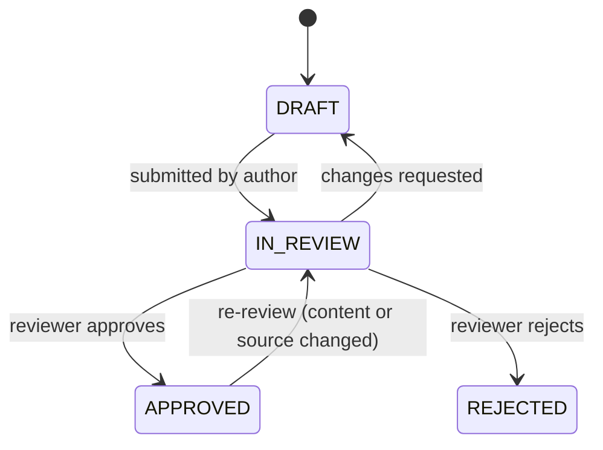
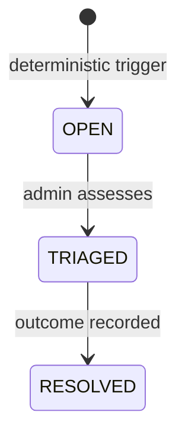

# NIVA — Medical Safety & Clinical Governance Plan

| Field | Value |
| --- | --- |
| Document | 06-medical-safety.md |
| Version | 1.0 (architecture baseline) |
| Task | 2-a |
| Related | 03-api-spec.md §4.10, 05-3d-asset-spec.md §11, 07-security-privacy.md, 08-ai-evaluation.md |

This plan is normative for every module that touches health information: content (C, K–O),
the AI assistant (J), symptom guidance (G), the 3D studio (D/E), and community (Q). Where
any other document is more permissive, this one wins (consistency rule 3 of
`01-system-architecture.md` §12).

## 1. Clinical scope classification

| Class | Definition | Examples in NIVA | Handling |
| --- | --- | --- | --- |
| Wellness/education | General information about pregnancy, nutrition, exercise, emotional wellbeing, birth preparation, postpartum recovery | Articles, timeline weeks, education tracks | Clinical review workflow (§7) before publication |
| Self-tracking | User-recorded personal observations with trend display | Symptom entries, journal, metric charts | Stored privately; entry write-path runs red-flag engine (§4); no interpretation beyond trends |
| Triage-adjacent guidance | Language that recognizes warning signs and directs to professional care | Red-flag escalation cards, AI refusal/redirect | Deterministic engine only; always refers to a clinician; never assesses |
| Prohibited | Diagnosis, treatment selection, medication dosing, interpreting lab/imaging results, pregnancy outcome prediction | — | Hard-blocked in LLM contract (§5); not present in content |

Boundary statement: NIVA is not a medical device and does not perform diagnosis, treatment,
or clinical decision support for clinicians. Content and code are written to avoid device
regression; §12 lists the regulatory scoping questions that qualified counsel must confirm
per jurisdiction.

## 2. Actors and responsibilities

| Actor | Responsibility |
| --- | --- |
| Content authors (ADMIN/editor) | Draft bilingual content with citations; never publish directly |
| Clinical reviewer (CLINICAL_REVIEWER role) | Review content/assets; approve, reject, request changes; decisions audited |
| Safety engineer (build team) | Maintain red-flag patterns; add patterns on incident evidence |
| Platform admin | Triage SafetyEvents; manage moderation; cannot self-approve content (separation of duties) |

Reviewer qualification is an operational requirement (obstetric or midwifery background);
the platform enforces the role, the organization enforces the qualification. In the current
sandbox no external reviewer has been recruited (DEFERRED, 00 §5 module U) — therefore no
content is approved (§9).

## 3. Red-flag taxonomy

Pattern categories (bilingual fa/en), each with deterministic detection in
`src/lib/safety`:

| # | Category | Example signals (illustrative, not the full pattern list) | Severity |
| --- | --- | --- | --- |
| 1 | Bleeding | heavy bleeding, clotting descriptions; «خونریزی شدید» | CRITICAL (any trimester) |
| 2 | Severe abdominal/pelvic pain | «درد شدید شکم», severe one-sided pain | CRITICAL |
| 3 | Preeclampsia signs | severe headache + visual disturbance + swelling | CRITICAL |
| 4 | Fever in pregnancy | high fever reports | HIGH |
| 5 | Reduced fetal movement (3rd trimester) | «بچه کمتر تکان می‌خورد», "baby moving less" | CRITICAL |
| 6 | Hyperemesis signs | cannot keep fluids, fainting, no urination | HIGH |
| 7 | Preterm labor signs | regular contractions before 37 weeks, pelvic pressure | CRITICAL |
| 8 | Fluid loss | water breaking / constant leaking | HIGH |
| 9 | Postpartum hemorrhage signs | soaking pads, large clots after birth | CRITICAL |
| 10 | Postpartum infection signs | fever + wound pain/redness | HIGH |
| 11 | Chest pain / breathlessness | «درد قفسه سینه», dyspnea at rest | CRITICAL |
| 12 | Seizure / loss of consciousness | «تشنج», fainting | CRITICAL |
| 13 | Mental health crisis | suicidal ideation, self-harm intent | CRITICAL |
| 14 | Severe emotional distress | persistent hopelessness, panic descriptors | HIGH |

Severity maps to response: CRITICAL/HIGH produce escalation cards; MEDIUM/LOW (reserved for
community flagging signals) do not.

## 4. Deterministic escalation rules

1. Placement: the scan runs server-side, before the LLM, on every AI chat message and
   symptom-entry note. There is no configuration under which a red-flag match reaches the
   LLM (`01-system-architecture.md` §6).
2. Matching: bilingual keyword + pattern lists (normalized text; Persian characters
   normalized: ی/ي, ک/ك, diacritics stripped). Patterns are data with ids, reviewable and
   versionable.
3. On match: the pipeline (a) writes a SafetyEvent row (OPEN) with category/severity/source,
   (b) returns an escalation response — an emergency card with the category, localized
   urgency text, and emergency numbers — and (c) stops. For chat, the assistant reply IS the
   escalation card; the LLM is bypassed entirely.
4. Emergency card content: directive, calm language ("contact emergency services now"),
   Iran numbers 115 (EMS) and 123 (social emergency), plus an explicit instruction to use
   the user's local emergency number outside Iran — never an invented foreign number.
5. Safe-side bias: ambiguous phrases that half-match a HIGH/CRITICAL pattern escalate
   (false positives are acceptable; false negatives are not). Pattern tuning may lower
   sensitivity only with logged justification, never for CRITICAL categories.
6. Persistence: escalation responses are stored as AIMessage/SymptomEntry flags linked to
   the SafetyEvent, so clinical governance can audit what was shown.

## 5. LLM hard constraints (system contract)

The system prompt and pipeline enforce, for every grounded answer:

1. Educational information only; NIVA does not diagnose, prescribe, or interpret the user's
   specific test results.
2. Never dismiss symptoms ("it's probably nothing" is forbidden phrasing).
3. For any concerning symptom: advise contacting a clinician/midwife, matching severity.
4. Refuse out-of-scope requests (drug dosing, "should I induce labor", determining fetal
   sex for decision-making, interpreting ultrasounds) with a respectful redirect.
5. Ground claims in retrieved documents; cite document ids; if retrieval is empty for a
   health question, say so and refer to professional sources rather than improvising.
6. No medication names with dosing; no "safe in week X" claims about substances.
7. Response validation rejects outputs that violate 1–4 (marker heuristics + reviewer
   sampling); violations are logged and the answer is replaced by the referral fallback.

The LLM gateway is called only from server code (`z-ai-web-dev-sdk`), after safety scanning,
with rate limits and quotas (`03-api-spec.md` §3).

## 6. Citation and provenance requirements

- Every educational article lists its sources as ScientificSource records (title,
  publisher, year, citation in fa/en, optional URL, optional evidence level).
- Every AI answer carries document-level citations (docId + title) rendered as badges
  (04 §10); uncited health claims are a validation failure (§5.5).
- Knowledge base documents map to sources; the knowledge base is versioned with the build
  (`src/data/medical-knowledge.ts`) so any historical answer can be traced to the corpus
  version that produced it.
- Reference bodies used for content drafting (not as quoted text): WHO antenatal care
  recommendations (2016), ACOG guidance, ISUOG ultrasound guidance. NIVA paraphrases with
  citation; it does not reproduce copyrighted text.

## 7. Clinical review workflow

- Only CLINICAL_REVIEWER decisions move content to APPROVED; every transition writes a
  ClinicalReview row and an AuditEvent (`02-data-model.md` §5, §11).
- Admins cannot approve their own drafts (separation of duties).
- Reviewers see content in both languages side by side with the citation list; rejection
  requires a reason (stored, visible to authors).
- The review queue API is in `03-api-spec.md` §4.16.

## 8. Content versioning

Approved content is immutable; edits create a new version row (`version` + `supersedesId`)
which re-enters the workflow at DRAFT. Users always see the currently approved version;
a superseding version that is REJECTED leaves the previous approved version live. A changelog
(text) per version records what changed and why. 3D asset tables follow the same pattern via
`model_version` (05 §4, §12).

## 9. Approval honesty statement

No content, asset, or AI behavior in this platform is clinically approved until a documented
human review decision by a qualified reviewer exists in the database. The current sandbox
build contains no such decisions; therefore all shipped content and all anatomical assets
carry DEMONSTRATION/unapproved status or are withheld from user-facing publication, and no
surface claims clinical endorsement. This statement may only be superseded by real
ClinicalReview evidence — never by documentation.

## 10. Incident management — SafetyEvent lifecycle

- SLAs (target): CRITICAL reviewed within 1 business day, HIGH within 3.
- Triage records who/when/what in the SafetyEvent row; resolution notes are mandatory.
- A pattern that fires unexpectedly often is a signal: recurring false positives go to
  pattern tuning (§4.5); any missed true case reported by users is a severity-1 product
  incident — pattern added, regression test added (`08-ai-evaluation.md` §4), worklog entry.
- SafetyEvent counts appear in the admin metrics endpoint (`03-api-spec.md` §4.16) and feed
  the monitoring plan (`08-ai-evaluation.md` §9).

## 11. Model evaluation plan (summary)

Full plan in `08-ai-evaluation.md`: bilingual red-flag regression catalog (every pattern
MUST bypass the LLM), injection resistance cases, groundedness/citation checks, escalation
correctness sampling, and a human review loop over sampled transcripts. Suites are
specified there and not executed in this sandbox; manual browser verification evidence is
recorded in the worklog.

## 12. Regulatory scoping questions (require qualified legal/clinical counsel)

This section lists questions; it does NOT answer them and no statement in this suite is
legal advice.

- Iran: classification under the national food and drug authority's software/medical device
  framework — does wellness education + self-tracking fall outside device rules under all
  foreseeable features (including future AR)? Requirements for health data hosting inside
  Iran; Persian-language consumer protection and e-commerce rules for subscriptions via
  domestic gateways.
- EU/international: GDPR lawful bases for health-adjacent data (explicit consent likely
  needed), special-category data handling, DPIA trigger assessment, data residency for
  exports; similar reviews for other target jurisdictions.
- App stores (target channel): health-app policy compliance, "not a medical device"
  declaration requirements, privacy nutrition labels/manifests, and any restrictions on
  AI-generated health advice in consumer apps.
- Clinical: does any planned feature (e.g., kick-count tracking, contraction timers) push
  the product into regulated territory? Each such feature requires a written scope review
  before implementation.

## 13. Change control for this plan

Amendments to red-flag patterns, LLM constraints, or the workflow require: a worklog entry,
regression additions in `08-ai-evaluation.md` §4, and — for anything safety-relevant —
sign-off recorded as an AuditEvent. Emergency pattern hotfixes may ship first and document
immediately after, never later than the next worklog entry.
