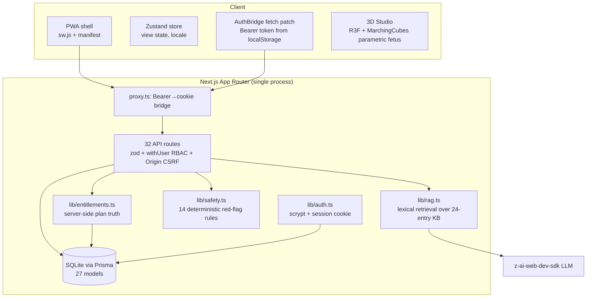

# NIVA — Phase 0 Repository Audit (Evidence-Based)

> Audit date: 2026-10-19 · Auditor: integrated Phase 0 team (3 parallel audit agents + config verification + baseline toolchain runs)
> Method: every finding validated against actual code with `file:line` evidence. No assumption carried over from prior sessions.

---

## 1. Scale & Composition

| Metric | Value |
| --- | --- |
| TypeScript source files (src/) | 127 (~14,800 LOC) |
| Prisma models | 27 |
| API route files | 32 (56 handler methods) |
| UI views | 20 + immersive 3D studio |
| i18n dictionary keys | 362 (fa/en symmetric, verified by diff) |
| Tests | **0** (no test runner, no CI) |
| CI/CD | **None** |

## 2. Architecture Baseline (as-is)

**Deployment shape:** modular monolith (Next.js single service + SQLite file + in-memory rate limits/queues). No background worker, no object storage, no CDN for assets, no email/push channel.

## 3. Capability Inventory

### ✅ Existing & Working (verified by execution, not claims)
- Auth: register/login/logout/me, scrypt hashing, 256-bit session tokens, HttpOnly cookie + Bearer-token hybrid for embedded contexts (`src/lib/auth.ts`, `src/proxy.ts`, `src/lib/auth-bridge.tsx`). End-to-end verified with browser automation (worklog `hotfix-login-1`).
- Gestational dating engine: LMP / CRL / clinician-determined / IVF with conflict resolution and clinician lock (`src/lib/gestational.ts`, `api/pregnancy`).
- 20 localized feature views (fa/en), RTL-first, 44px touch targets on primary controls.
- Real-time parametric 3D fetal studio (MarchingCubes, 12 gestational keyframes, 3 quality tiers, auto-downgrade ≤640px) with text accessibility alternative.
- Deterministic medical safety layer: 14 bilingual red-flag regex rules; EMERGENCY short-circuits **before** LLM (`lib/safety.ts`, `lib/rag.ts:113-123`).
- RAG assistant with structurally honest citations (citations = retrieved KB entries only; fabrication impossible by construction) + free-tier daily quota.
- Server-side entitlements enforced on: AI cap, family access, data export, advanced 3D layers.
- Clinical review workflow with reviewer identity + version bump; content truthfully labeled IN_REVIEW/APPROVED.
- GDPR export (works, but paywalled — see risks) and hard delete with FK cascade.
- PWA: installable manifest, network-first SW; **`/api/` explicitly never cached** (`sw.js:22`) — private health data cannot persist in SW cache.
- Append-only audit trail with PHI-field redaction (`lib/audit.ts:28-36`).

### ⚠️ Incomplete / Partial
| Capability | Gap |
| --- | --- |
| Community | Posts stuck PENDING forever — **no approve/reject route exists**; `ModerationAction` model has zero references |
| Partner/family access | Grants auto-ACTIVATE without partner consent; **no route ever serves partner-scoped data** (advertised feature non-functional) |
| Consent | Withdrawal impossible — upsert always resets `withdrawAt:null` (`privacy/consent/route.ts:15-18`) |
| Subscriptions | Correct skeleton (HMAC webhook, PENDING-only, idempotency column) but 100% sandbox: client mints its own payment signatures; no PSP; no trials/refunds/period-end grace |
| Reminders/notifications | DB rows only; **no scheduler, no email/SMS/push** — nothing fires without a client poll |
| Data export | 402 for FREE plan (GDPR problem) |
| Safety coverage | Journal + community free-text not scanned by red-flag rules; BP ≥140/90 raises no SafetyEvent; LLM output never re-scanned |
| Admin | users/finance read-only; no suspend/role-change/refund; no tickets; feature flags stored but consumed by nothing |
| i18n | ~60% of educational copy lives as inline locale ternaries outside the dictionary; raw enums rendered in UI; 8 hardcoded EN aria-labels |
| SW/offline | Unbounded runtime cache, no eviction; offline = empty views with no error UI |

### ❌ Missing
- Test suite (unit/integration/E2E/a11y/security), CI/CD, staging/production environments.
- Background job queue; object storage/CDN for versioned 3D/media assets; structured logging w/ redaction, tracing, metrics, alerting.
- Postgres migration path execution; migrations discipline (`db:push --accept-data-loss` is the current workflow).
- AI evaluation datasets/regression harness; LLM provider abstraction beyond single SDK; response caching for safe content.
- Analytics (product metrics, activation/retention); A/B infra; SEO per-view metadata (client-side SPA routing).

### 💥 Broken (must fix)
1. **Brand typography never applies** — `--font-niva-sans` / `--font-niva-rtl` referenced in `globals.css:9,131,142` but never defined; Vazirmatn/Inter CDN load is wasted; entire UI renders in fallback fonts. Highest visual-identity impact.
2. **`tailwind.config.ts` is a dead v3-style artifact** (hsl-var mappings vs oklch tokens; wrong content globs; not referenced by Tailwind 4).
3. GPU memory leaks in studio: placenta vessel `TubeGeometry`s never disposed on rebuild (`fetus-model.tsx:460-465`), glow `CanvasTexture` never disposed (`fetus-model.tsx:326`, `scene.tsx:58`).
4. 28px hover-only (`opacity-0`) delete buttons in journal/records — invisible to keyboard users (WCAG 2.2 AA failure).
5. Sandbox checkout endpoint mints valid payment signatures via unauthenticated GET (`subscription/cancel/route.ts:9-22`).
6. `/api/auth/demo` falls back to the **ADMIN** account for any anonymous visitor when demo user is missing (`demo/route.ts:16-18`).
7. Silent failure UX in all data views (`fetch().catch(()=>null)` → unexplained empty shells, no retry).

## 4. Explicit Investigations (named in mission, verified in code)

| Item | Verdict | Evidence |
| --- | --- | --- |
| `ignoreBuildErrors` | **true — must remove** | `next.config.ts:7-9` |
| `noImplicitAny` | **false — must remove** (weakens `strict: true`) | `tsconfig.json` |
| `reactStrictMode` | false (double-render masking) | `next.config.ts` |
| Demo/admin auth | Demo endpoint falls back to ADMIN; seed credentials committed | `demo/route.ts:16-18`, `seed.ts:50-52` |
| Session exposure | Session token mirrored to localStorage (XSS = theft); acceptable tradeoff for embedded preview, must be documented + CSP-compensated | `lib/auth-token.ts`, `auth-bridge.tsx` |
| SameSite/CSRF | SameSite=None; Secure on HTTPS (embedding support); `assertSameOrigin` **fails open when Origin absent** (`api.ts:21`); logout has no CSRF check | `lib/auth.ts:48-55`, `lib/api.ts:17-28` |
| Verbose DB query logging | `log: ['query']` unconditional — **all health queries dumped to logs** | `lib/db.ts:10` |
| AI rate-limit races | In-memory fixed-window keyed on spoofable `x-forwarded-for`; AI quota is count-then-act TOCTOU (concurrency defeats FREE 5/day cap) | `rate-limit.ts:13-28`, `ai/chat/route.ts:28-42,68-77` |
| `db:push --accept-data-loss` | Present in scripts; no migrations directory in use | `package.json` scripts |

## 5. Dependency & Integration Map

- **Runtime deps (key):** next 16, react 19, @tanstack/react-query, zustand, three + @react-three/fiber + drei, prisma 6, zod, next-themes, tailwind 4, full shadcn/ui set, @dnd-kit, mdxeditor, recharts.
- **External calls:** Google Fonts CDN (unversioned, uncached offline), z-ai-web-dev-sdk LLM (server-side only), no other third-party integrations (no PSP, no email, no push, no analytics).
- **Dead/scaffold:** `examples/websocket` (socket.io not installed; excluded from app), `skills/` (sandbox tooling), `mini-services/.gitkeep`.

## 6. Data Flow & Entity Notes (27 models)

- Cascade deletes correct on 18 user-owned relations; 3 SetNull (reviewer, partnerUser, audit actor).
- Integrity gaps: `ModerationAction` has **no FK relations** (orphanable); `SafetyEvent.userId` no FK → delete residue; statuses/roles are free strings (no enum constraint); JSON persisted as strings; nothing prevents two ACTIVE pregnancies per user (app-level check only); expired sessions removed only lazily.
- `ScientificSource` is seed-written but read-never.

## 7. Baseline Build/Test Reports (execution evidence)

- `bunx tsc --noEmit` (2026-10-19T20:56Z): **0 errors in `src/`**. 4 errors exist in `examples/` + `skills/` sandbox scaffolding (socket.io-client types, 2 minor) — currently hidden from `next build` by `ignoreBuildErrors: true`; must exclude these dirs from tsconfig.
- `bun run lint`: **0 errors, 1 warning** (pre-existing `no-page-custom-font` in `layout.tsx:36`).
- `next build`: **not run in sandbox** (environment constraint: dev-server-only port policy). Tracked as backlog item to run in CI.
- Tests: none exist — baseline is "no suite".

## 8. Top Risks (summary — full register in 01-risk-register.md)

| # | Risk | Sev | Evidence |
| --- | --- | --- | --- |
| R-01 | Payment self-minting (client signs its own webhook HMAC) | CRITICAL | `subscription/cancel/route.ts:9-22`, `webhook/route.ts:25` |
| R-02 | Unauthenticated admin fallback in demo login | CRITICAL | `demo/route.ts:16-18` |
| R-03 | No DB transactions anywhere (pregnancy dating, appointment chains, webhook writes) | HIGH | grep: zero `$transaction` |
| R-04 | AI quota TOCTOU + spoofable XFF rate limiting | HIGH | `ai/chat/route.ts`, `rate-limit.ts` |
| R-05 | PHI to logs via unconditional query logging | HIGH | `db.ts:10` |
| R-06 | GDPR: paywalled export, consent withdrawal impossible, delete residue | HIGH | `privacy/*`, schema |
| R-07 | LLM output never re-scanned; journal/community bypass red-flag scan | HIGH | `rag.ts:146-148`, `journal/route.ts` |
| R-08 | Community moderation dead-end (no approval route) | HIGH | `community/route.ts` |
| R-09 | Brand fonts undefined → identity failure | HIGH | `globals.css` |
| R-10 | SPA routing ceiling: 20+ views, no deep links/SEO/code-splitting | MEDIUM | `page.tsx:7-28` |
| R-11 | GPU leaks in 3D studio | MEDIUM | `fetus-model.tsx` |
| R-12 | `ignoreBuildErrors` + `noImplicitAny:false` + no CI | MEDIUM | configs |
